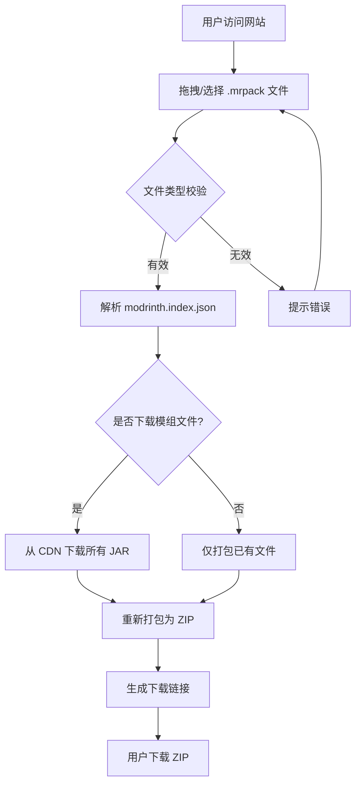

# MRPack to ZIP 转换器 - 产品需求文档 (PRD)

## 1. 产品概述

MRPack to ZIP 是一个免费在线工具，用于将 Modrinth 模组包文件（.mrpack）转换为标准 ZIP 格式，方便 Minecraft 玩家在各种启动器和模组加载器中使用。所有处理均在浏览器端完成，文件不会上传到服务器，确保隐私安全。

- **目标用户**：Minecraft 模组玩家、模组包开发者、需要在不同启动器间迁移模组包的用户
- **核心价值**：解决 .mrpack 格式兼容性问题，提供一键转换 + 模组文件下载能力，无需安装任何软件

## 2. 核心功能

### 2.1 用户角色
| 角色 | 注册方式 | 核心权限 |
|------|---------|---------|
| 普通访客 | 无需注册 | 使用转换工具、浏览所有文档内容 |

### 2.2 功能模块
1. **首页（单页应用）**：转换工具 + 拖拽上传 + 选项配置 + 教育内容
2. **转换工具模块**：文件上传、转换选项、进度显示、下载结果
3. **内容文档模块**：使用指南、FAQ、启动器兼容性、格式说明

### 2.3 页面详情
| 页面名称 | 模块名称 | 功能描述 |
|---------|---------|---------|
| 首页 | 顶部导航 | Logo + 锚点导航（转换器、说明、FAQ、兼容性） |
| 首页 | Hero 转换器 | 拖拽上传区 + 浏览文件按钮 + 转换选项面板 |
| 首页 | 转换选项 | 下载模组文件、规范化文件名、保留原结构、包含索引文件 |
| 首页 | 转换进度 | 实时进度条、当前处理状态、下载按钮 |
| 首页 | 关于工具 | 工具介绍 + 核心特性列表 + 标签 |
| 首页 | 工作原理 | 三步骤说明（上传 → 处理 → 转换下载） |
| 首页 | 技术细节 | .mrpack 与标准 ZIP 结构对比 |
| 首页 | 使用指南 | 手动打开方法、JAR 提取、故障排除 |
| 首页 | 常见问题 | 折叠式 FAQ 列表 |
| 首页 | 启动器兼容性 | 兼容性表格 + 各启动器安装指南 |
| 首页 | MRPACK 格式说明 | 结构、优势、历史、格式对比表 |
| 馶页 | 页脚 | 版权信息、链接 |

## 3. 核心流程

**用户主流程**：访问网站 → 拖拽 .mrpack 文件 → 选择转换选项 → 等待处理 → 下载 ZIP 文件

**转换处理流程**：
1. 用户拖拽或浏览选择 .mrpack 文件
2. 浏览器端使用 JSZip 读取 .mrpack（本质是 ZIP）
3. 解析 modrinth.index.json 获取模组列表
4. 若启用"下载模组文件"，则从 CDN 下载所有引用的 JAR 文件
5. 根据选项重新打包为标准 ZIP
6. 生成下载链接供用户下载

## 4. 用户界面设计

### 4.1 设计风格
- **主色调**：Minecraft 风格的草绿色 (#4CAF50) 作为主色，深墨绿 (#1B3A2F) 作为深色背景，米白色 (#F5F3E7) 作为浅色背景
- **辅助色**：橙色 (#FF8C42) 用于强调和进度条，深灰 (#2C2C2C) 用于文字
- **按钮风格**：略带 3D 立体感的圆角按钮，主按钮绿色带阴影，次按钮描边样式
- **字体**：标题使用带像素游戏感的 "Press Start 2P" 或 "JetBrains Mono"，正文使用 "Manrope" 保持可读性
- **布局风格**：单页滚动布局，顶部固定导航，各内容区块卡片式分隔
- **图标风格**：使用 Lucide 图标库，简洁线性风格
- **氛围细节**：微妙的网格纹理背景、Minecraft 方块装饰元素、轻微的噪点纹理

### 4.2 页面设计概览
| 页面名称 | 模块名称 | UI 元素 |
|---------|---------|---------|
| 首页 | 顶部导航 | 固定顶部、半透明毛玻璃背景、Logo+锚点链接、CTA 按钮 |
| 首页 | Hero 转换器 | 大标题 + 副标题 + 拖拽上传区（虚线边框、悬停高亮）+ 选项切换面板 |
| 首页 | 转换进度 | 模态进度条、百分比、状态文字、动画图标 |
| 首页 | 关于工具 | 双栏布局：左侧文字介绍+特性列表，右侧装饰图/标签云 |
| 首页 | 工作原理 | 三栏卡片：每步带编号图标+标题+描述 |
| 首页 | 技术细节 | 双栏对比卡片：.mrpack 结构 vs 标准 ZIP 结构 |
| 首页 | 使用指南 | 标签页切换：手动打开/JAR 提取/故障排除 |
| 首页 | FAQ | 手风琴折叠面板，点击展开/收起 |
| 首页 | 兼容性表格 | 响应式表格，支持图标+颜色标记 |
| 首页 | 启动器指南 | 网格卡片布局，每个启动器一张卡片 |
| 首页 | 格式说明 | 代码块展示 JSON 结构 + 历史时间线 + 对比表 |

### 4.3 响应式设计
- **桌面优先**：宽屏下展示完整双栏/三栏布局
- **平板适配**：双栏合并为单栏，表格保持横向滚动
- **移动端适配**：所有多栏布局变为单栏，导航折叠为汉堡菜单，上传区域全宽，表格转为卡片式
- **触控优化**：按钮和上传区域增大点击区域，支持触摸拖拽

### 4.4 3D 场景指南
不适用（本项目无 3D 场景需求）
