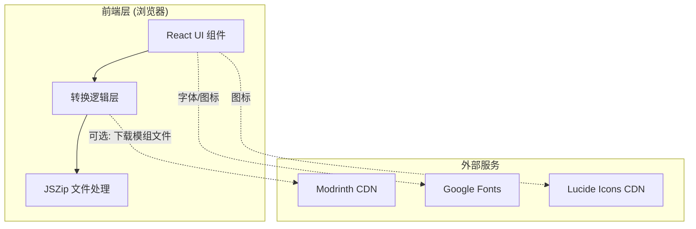

# MRPack to ZIP 转换器 - 技术架构文档

## 1. 架构设计

本项目为纯前端单页应用，所有文件处理在浏览器端完成，无需后端服务。



## 2. 技术说明

- **前端框架**：React@18 + Vite
- **样式方案**：Tailwind CSS@3 + 自定义 CSS 变量
- **核心依赖库**：
  - `jszip@3.10.1`：ZIP 文件读取与生成（核心）
  - `lucide-react`：图标库
  - `file-saver@2.0.5`：文件下载
- **初始化工具**：vite-init (React + TypeScript 模板)
- **后端**：无（纯客户端处理）
- **数据库**：无（无持久化数据）

## 3. 路由定义

| 路由 | 用途 |
|------|------|
| `/` | 首页（单页应用，包含转换器与所有内容区块，通过锚点滚动定位） |

## 4. API 定义

无后端 API。所有处理在客户端完成。

**Modrinth CDN 下载**（可选功能）：
- 直接从 `modrinth.index.json` 中的 `downloads` 数组获取 URL
- 使用浏览器原生 `fetch` API 下载 JAR 文件
- 需处理 CORS（Modrinth CDN 支持 CORS）

## 5. 服务端架构

不适用（纯前端项目）

## 6. 数据模型

### 6.1 核心数据结构

**modrinth.index.json 结构**（解析目标）：
```typescript
interface ModrinthIndex {
  formatVersion: number;
  game: string;
  versionId: string;
  name: string;
  summary?: string;
  files: ModrinthFile[];
  dependencies: Record<string, string>;
}

interface ModrinthFile {
  path: string;
  hashes: { sha1: string; sha512: string };
  downloads: string[];
  fileSize: number;
  env?: { client: string; server: string };
}
```

**转换选项**：
```typescript
interface ConvertOptions {
  downloadModFiles: boolean;    // 下载模组文件
  normalizeFilenames: boolean;  // 规范化文件名
  keepOriginalStructure: boolean; // 保留原结构
  includeIndexFile: boolean;    // 包含索引文件
}
```

**转换状态**：
```typescript
type ConvertStatus = 'idle' | 'parsing' | 'downloading' | 'packaging' | 'done' | 'error';

interface ConvertState {
  status: ConvertStatus;
  progress: number;        // 0-100
  currentFile?: string;    // 当前处理的文件名
  totalFiles: number;
  processedFiles: number;
  error?: string;
  downloadUrl?: string;    // Blob URL
  outputFileName?: string;
}
```

### 6.2 数据定义语言

不适用（无数据库）

## 7. 模块划分

### 7.1 组件结构
```
src/
├── components/
│   ├── Navbar.tsx              # 顶部导航
│   ├── Converter/
│   │   ├── Converter.tsx       # 转换器主组件
│   │   ├── DropZone.tsx        # 拖拽上传区
│   │   ├── OptionsPanel.tsx    # 转换选项面板
│   │   ├── ProgressBar.tsx     # 进度条
│   │   └── ResultCard.tsx      # 结果展示卡片
│   ├── sections/
│   │   ├── About.tsx           # 关于工具
│   │   ├── HowItWorks.tsx      # 工作原理
│   │   ├── TechnicalDetails.tsx # 技术细节
│   │   ├── UsageGuide.tsx      # 使用指南
│   │   ├── FAQ.tsx             # 常见问题
│   │   ├── LauncherCompat.tsx  # 启动器兼容性
│   │   └── FormatInfo.tsx      # 格式说明
│   └── ui/                     # 通用 UI 组件
├── lib/
│   ├── converter.ts            # 转换核心逻辑
│   └── utils.ts                # 工具函数
├── App.tsx
└── main.tsx
```

### 7.2 核心转换逻辑（converter.ts）
- `parseMrpack(file: File): Promise<ModrinthIndex>` — 解析 .mrpack 文件
- `downloadModFile(url: string): Promise<Blob>` — 下载单个模组文件
- `convertToZip(file: File, options: ConvertOptions, onProgress: Callback): Promise<Blob>` — 主转换函数
- `normalizeFilename(name: string): string` — 规范化文件名
